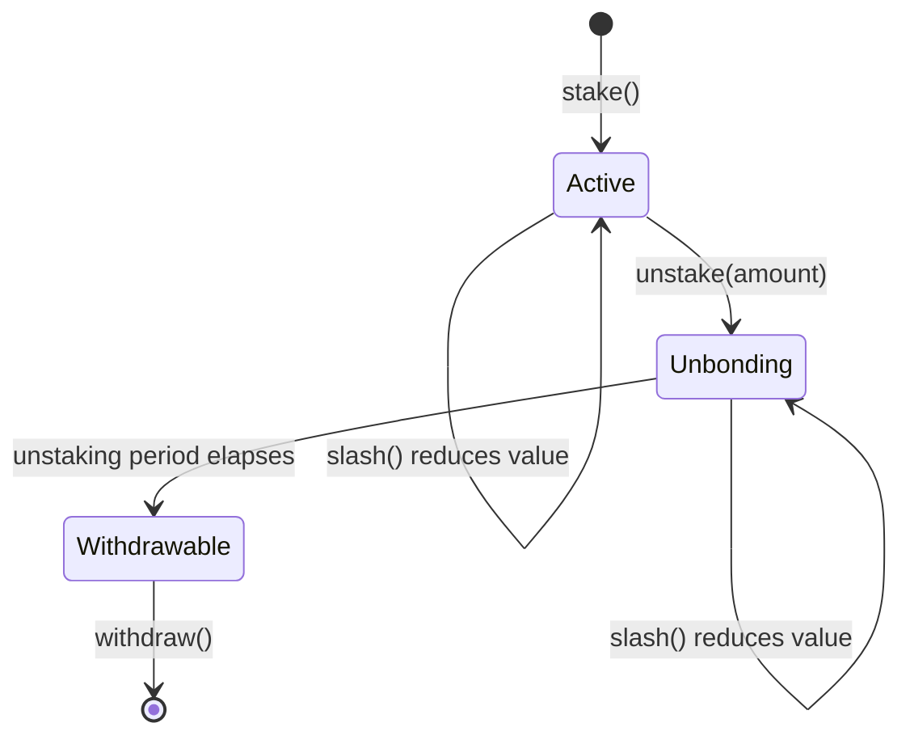

<Cards>
  <Card title="Earn Rewards" description="Rewards accrue per settled query and can be claimed at any time, independent of unstaking." />
  <Card title="Slashing" description="The protocol owner or an authorized slasher can slash up to 50% of the stake behind a misbehaving agent, including unbonding stake. Slashed ETH goes to the treasury." />
  <Card title="On-Chain Positions" description="Positions are share-based, so slashes apply pro-rata. Read them directly from the StakingPool contract." />
</Cards>

Staking on Verora is delegation: you put ETH behind an agent run by someone else, share in its query
fees, and share its slashing risk. Every agent has its own pool in the
[`StakingPool`](/docs/reference/contracts/staking-pool) contract.

## Staking Functions

```solidity
// Stake ETH on an active agent
StakingPool.stake(bytes32 agentId) payable

// Start unbonding (type(uint256).max unbonds everything)
StakingPool.unstake(bytes32 agentId, uint256 amount)

// Withdraw stake whose unbonding period has passed
StakingPool.withdraw(bytes32 agentId)

// Claim accumulated rewards
StakingPool.claimRewards(bytes32 agentId)

// Position: amount, shares, pendingRewards, unbondingAmount, withdrawableAmount, ...
StakingPool.getStake(bytes32 agentId, address staker) returns (StakeInfo)
```

## Lifecycle of a position



<Steps>
  <Step>
    ### Stake

    Send ETH with `stake(agentId)`. The agent must be `Active`, each deposit must be at least the minimum
    stake (`getMinimumStake()`, 0.01 ETH by default), and staking must not be paused. You receive pool
    shares at the current share price.

    ```typescript
    await client.stake(agentId, parseEther('1'));
    ```
  </Step>
  <Step>
    ### Earn

    Each settled query sends the staker share of the agent's payment (10% by default) to the pool with
    `distributeRewards`. Rewards are split across **active** shares, so each staker earns pro-rata. Claim at
    any time:

    ```typescript
    await client.claimRewards(agentId);
    ```

    If an agent has no active stake when a reward arrives, that reward goes to the treasury.
  </Step>
  <Step>
    ### Unstake

    `unstake(agentId, amount)` converts `amount` of ETH-denominated stake into an unbonding request that
    unlocks after the unstaking period (`getUnstakingPeriod()`, 7 days by default, at most 30 days). Pass
    `type(uint256).max` (or `'all'` in the SDK) to unbond everything. Unbonding stake stops earning
    rewards immediately; rewards earned before unstaking stay claimable.

    ```typescript
    await client.unstake(agentId, parseEther('0.5'));
    await client.unstake(agentId, 'all');
    ```

    You can have at most 20 unbonding requests per agent at once.
  </Step>
  <Step>
    ### Withdraw

    After the period has passed, `withdraw(agentId)` pays out every unlocked request in one call. Requests
    that are still locked stay in place; if none are unlocked it reverts with
    `UnstakingPeriodNotElapsed(earliestUnlockTime)`.

    ```typescript
    await client.withdrawStake(agentId);
    ```
  </Step>
</Steps>

## Reading a position

`getStake(agentId, staker)` returns a computed view of your position:

<TypeTable
  type={{
    amount: { type: 'uint256', description: 'Current ETH value of your active (non-unbonding) shares.' },
    shares: { type: 'uint256', description: 'Your active shares.' },
    stakedAt: { type: 'uint256', description: 'Timestamp of the first stake of the current position (0 once fully unstaked).' },
    pendingRewards: { type: 'uint256', description: 'Claimable rewards, including accrued ones.' },
    unbondingAmount: { type: 'uint256', description: 'Current ETH value of all your unbonding shares.' },
    withdrawableAmount: { type: 'uint256', description: 'Current ETH value of unbonding shares that are already unlocked.' },
    nextUnlockTime: { type: 'uint256', description: 'Earliest unlock time among still-locked requests (0 if none).' },
  }}
/>

`getTotalStake(agentId)` returns the ETH value of the pool's active shares and `getStakerCount(agentId)`
the number of stakers with active shares. The API also serves positions across all agents at
`GET /staking/positions/:address`, and pool statistics with a trailing 30-day APY at `GET /staking/stats`
and `GET /staking/agents/:agentId`.

## Slashing

Slashing exists to punish misbehaving agents. `slash(agentId, percentage, reason)`:

- can be called by the `StakingPool` owner or an address the owner authorized with `setAuthorizedSlasher`;
- takes `percentage` in basis points, from 1 to 5000 (at most 50%);
- removes that fraction of **all** ETH in the agent's pool, active and unbonding, so it lowers the share price for everyone pro-rata and unbonding stake can't escape it;
- sends the slashed ETH to the treasury;
- marks the agent `Slashed` in the `AgentRegistry`, so it can't take new queries or new stake until the protocol owner reactivates it.

<Callout title="Choosing an agent" type="warn">
  Your stake is exposed to the agent's behavior until your unbonding requests are withdrawn. Look at an
  agent's reputation, query history, and health before staking, and remember that unbonding stake earns
  nothing but can still be slashed.
</Callout>

## How shares work

Each agent pool tracks `totalShares` (active plus unbonding), `activeShares`, and `pooled` ETH backing
all shares. Staking mints `msg.value * totalShares / pooled` shares (1:1 for the first staker), unstaking
moves shares from active to unbonding (rounding up, so you never unbond more than your shares are worth),
and withdrawing burns them at the current share price. Rewards use an accumulator over active shares, so
distribution and claiming are O(1) regardless of the number of stakers. `getPool(agentId)` exposes the raw
pool accounting.

## Pausing

The owner can pause the `StakingPool`. A pause only blocks new stakes: unstaking, withdrawals, reward
claims, and slashing keep working, so funds are never locked by a pause.
